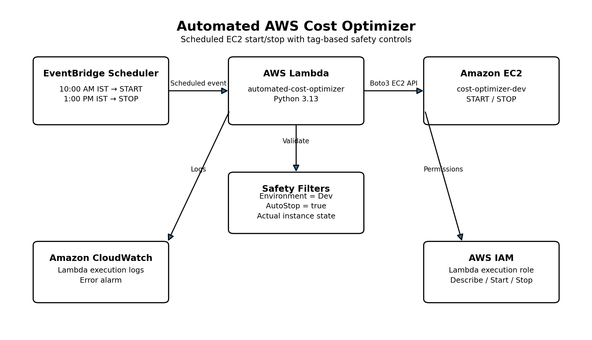

# Automated AWS Cost Optimizer

An automated AWS solution that manages the start and stop of development EC2 instances based on predefined tags and scheduled actions.

The project is designed to reduce unnecessary EC2 compute usage while ensuring that only explicitly tagged development instances are affected.

---

## 🎯 Objective

The main objectives of this project are:

- Automatically start development EC2 instances at a scheduled time.
- Automatically stop development EC2 instances at a scheduled time.
- Reduce unnecessary EC2 compute costs.
- Use resource tags as safety controls.
- Automate EC2 management using AWS Lambda and Boto3.
- Monitor Lambda execution using Amazon CloudWatch.
- Prevent accidental modification of unrelated EC2 instances.

---

## 🏗️ Architecture



### Architecture Flow

```text
EventBridge Scheduler
        │
        │ 10:00 AM → START
        │ 1:00 PM  → STOP
        ▼
AWS Lambda
automated-cost-optimizer
        │
        │ Boto3
        ▼
EC2 Tag & State Filters
        │
        ├── Environment = Dev
        ├── AutoStop = true
        └── Instance state
        │
        ▼
Development EC2 Instance
cost-optimizer-dev
        │
        ├── Start
        └── Stop

Lambda
   │
   ├── CloudWatch Logs
   └── CloudWatch Error Alarm

IAM
   └── Controls Lambda permissions

☁️ AWS Services Used
AWS Service	Purpose
AWS Lambda	Executes the EC2 cost optimization logic
Amazon EC2	Development instance managed by the solution
Amazon EventBridge Scheduler	Triggers Lambda automatically
Amazon CloudWatch	Stores Lambda logs and monitors errors
AWS IAM	Provides controlled permissions to Lambda


🔄 How It Works
1. Start Schedule
At 10:00 AM IST, EventBridge Scheduler invokes the Lambda with:
{
  "action": "start"
}

Lambda searches for EC2 instances that are:
Instance State = stopped
Environment = Dev
AutoStop = true

Matching instances are started.
2. Stop Schedule
At 1:00 PM IST, EventBridge Scheduler invokes the Lambda with:
{
  "action": "stop"
}

Lambda searches for EC2 instances that are:
Instance State = running
Environment = Dev
AutoStop = true

Matching instances are stopped.
🏷️ EC2 Safety Tags
The managed EC2 instance is configured with:
Name = cost-optimizer-dev
Environment = Dev
AutoStop = true

The Lambda only manages instances matching the required tags.
This provides a safety mechanism so that unrelated EC2 instances are not automatically started or stopped.
The project does not terminate EC2 instances.
⚙️ Lambda Implementation
Lambda Function
automated-cost-optimizer

Runtime
Python 3.13

Source Code
The Lambda source code is available in:
lambda/cost_optimizer.py

Main Logic
The Lambda:
1. Reads the requested action.
2. Validates the action.
3. Determines the required EC2 state.
4. Finds eligible instances using tags.
5. Starts or stops matching instances.
6. Logs the operation.
7. Returns the affected instance IDs.
Supported actions:
start
stop

Missing or invalid actions are rejected.
🔐 IAM Configuration
The Lambda uses the IAM role:
CostOptimizerLambdaRole

Required EC2 permissions:
ec2:DescribeInstances
ec2:StartInstances
ec2:StopInstances

CloudWatch logging permissions are provided through:
AWSLambdaBasicExecutionRole

The Lambda does not have:
ec2:TerminateInstances

This follows the principle of granting only the permissions required for the project.
⏰ EventBridge Scheduling
Two recurring EventBridge Scheduler schedules are configured.
Schedule	Time	Payload
cost-optimizer-start-10am	10:00 AM IST	{"action":"start"}
cost-optimizer-stop-1pm	1:00 PM IST	{"action":"stop"}


Timezone:
Asia/Calcutta (UTC+05:30)

Flexible time window:
OFF

This ensures the schedules execute at the configured time.
📊 CloudWatch Monitoring
Lambda execution logs are stored in:
/aws/lambda/automated-cost-optimizer

The project also includes a CloudWatch alarm:
CostOptimizer-Lambda-Errors

Alarm Configuration
Namespace: AWS/Lambda
Metric: Errors
Statistic: Sum
Period: 5 minutes
Threshold: Errors >= 1

CloudWatch logs provide visibility into:
- Lambda execution
- Eligible EC2 instances
- Start operations
- Stop operations
- Total affected instances
- Invalid or missing actions
🧪 Testing
The Lambda was tested with valid and invalid inputs.
Test 1: Start Instance
Input:
{
  "action": "start"
}

Result:
Status: 200
Action: start
Affected instances: 1

The tagged development EC2 instance was successfully started.
Test 2: Stop Instance
Input:
{
  "action": "stop"
}

Result:
Status: 200
Action: stop
Affected instances: 1

The tagged development EC2 instance was successfully stopped.
Test 3: Missing Action
Input:
{}

Result:
Status: 400
Action is required. Use 'start' or 'stop'.

No EC2 action was performed.
This test confirms that the Lambda does not assume a default action when the input is incomplete.
📋 Example CloudWatch Logs
Successful START operation:
Cost Optimizer action: start
Eligible instance found: i-02c1d2541e950bc6c
START action performed: i-02c1d2541e950bc6c
Total instances affected: 1

Successful STOP operation:
Cost Optimizer action: stop
Eligible instance found: i-02c1d2541e950bc6c
STOP action performed: i-02c1d2541e950bc6c
Total instances affected: 1

Invalid request:
No action provided.

🛡️ Security and Safety
The project uses multiple safety controls:
- Only development instances are targeted.
- Environment=Dev is required.
- AutoStop=true is required.
- Actual EC2 instance state is checked before performing an action.
- Missing actions are rejected.
- Invalid actions are rejected.
- Lambda has no EC2 termination permission.
- The solution only performs StartInstances and StopInstances.
- The EC2 instance is not blindly terminated or deleted.
📁 Project Structure
automated-aws-cost-optimizer/
│
├── README.md
├── .gitignore
│
├── lambda/
│   └── cost_optimizer.py
│
├── architecture/
│   └── architecture.png
│
└── screenshots/

The EC2 .pem key file is kept locally and excluded from Git using .gitignore.

🚀 Deployment / Setup
Step 1: Create EC2 Instance
Create a development EC2 instance and configure:
Environment = Dev
AutoStop = true

Step 2: Create IAM Role
Create a Lambda execution role with:
ec2:DescribeInstances
ec2:StartInstances
ec2:StopInstances

and CloudWatch logging permissions.
Step 3: Create Lambda
Create the Lambda function:
automated-cost-optimizer

Use:
Runtime: Python 3.13

Upload the code from:
lambda/cost_optimizer.py

Step 4: Configure EventBridge Scheduler
Create two recurring schedules:
10:00 AM IST → {"action":"start"}
1:00 PM IST  → {"action":"stop"}

Set the timezone to:
Asia/Calcutta (UTC+05:30)

Step 5: Configure CloudWatch
Verify the Lambda log group:
/aws/lambda/automated-cost-optimizer

Create an alarm for Lambda errors.
Step 6: Test
Test:
{"action":"start"}

{"action":"stop"}

and:
{}

Verify the EC2 state and CloudWatch logs after each test.
💰 Cost Considerations
The main purpose of this project is to reduce unnecessary EC2 compute usage.
Stopping an EC2 instance prevents ongoing EC2 instance compute charges while it is stopped.
However, attached resources such as EBS volumes can continue to generate charges even when the EC2 instance is stopped.
The project therefore focuses on reducing unnecessary compute runtime rather than claiming that stopping an instance makes the entire workload free.
⚠️ Limitations
- The current implementation uses fixed start and stop schedules.
- EC2 instances must be correctly tagged to be managed.
- The solution currently manages EC2 instances only.
- Stopped EC2 instances can still incur EBS storage charges.
- CloudWatch alarm notifications are not configured with an SNS notification action.
- The solution does not terminate or delete unused resources.
🔮 Future Enhancements
Possible future improvements include:
- SNS notifications for Lambda failures.
- Configurable working hours.
- Support for multiple environments.
- Cost reporting dashboard.
- AWS Cost Explorer integration.
- Detection of idle EC2 resources.
- Support for additional AWS resource types.
- Web dashboard for managing optimization schedules.
📚 Key Learnings
This project provided practical experience with:
- AWS Lambda and Python
- Boto3 and EC2 automation
- EventBridge Scheduler
- IAM permissions and least privilege
- CloudWatch Logs and alarms
- EC2 resource tagging
- Serverless automation
- AWS cost optimization
- Safe cloud-resource automation
- Testing and monitoring AWS workloads
📸 Project Screenshots
Screenshots demonstrating the AWS implementation are available in:
screenshots/

Recommended evidence includes:
1. EC2 instance and tags
2. Lambda function
3. Lambda successful START test
4. Lambda successful STOP test
5. EventBridge START schedule
6. EventBridge STOP schedule
7. CloudWatch Logs
8. CloudWatch Error Alarm
9. IAM role permissions
👩‍💻 Author
Anuja Gaikwad
AWS | Python | Cloud | AI & Data Analytics
